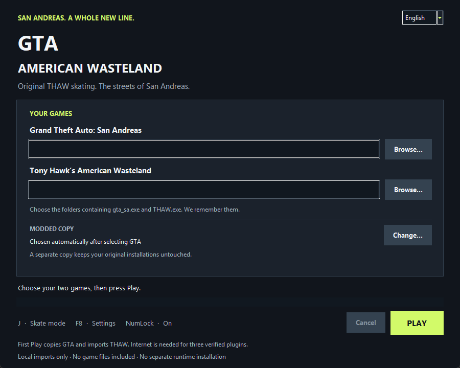

# GTA American Wasteland

**San Andreas na desce, z oryginalnym silnikiem rozgrywki THAW.**

[English](README.md) · [Budowanie ze źródeł](docs/BUILDING.md) · [Licencje zależności](THIRD_PARTY_NOTICES.md)

Nieoficjalny mod do klasycznego **Grand Theft Auto: San Andreas** na Windows, przeznaczony do gry jednoosobowej. Przełączaj CJ-a między GTA a jazdą na desce, wykonuj oryginalne triki i combosy z Tony Hawk's American Wasteland, grinduj po odpowiednich krawędziach i strzelaj podczas jazdy.

**Wersja 1.0 preview:** działająca integracja nadal poddawana testom. Niektóre powierzchnie, przejścia animacji i krótkie przycięcia wymagają dalszych poprawek. Nie jest to gwarancja pełnej zgodności z THAW ani każdym modem GTA.

## Uruchomienie

1. Pobierz **ZIP z launcherem Windows** z zakładki Releases tego repozytorium. Automatyczne archiwa „Source code” są dla programistów.
2. Wypakuj cały ZIP do zapisywalnego folderu poza obiema grami. Zachowaj wszystkie pliki razem.
3. Otwórz **GTA American Wasteland.exe** i wybierz **PL** lub **EN**.
4. Wskaż folder oryginalnego **GTA San Andreas** oraz oryginalnego **Tony Hawk's American Wasteland**.
5. Kliknij **Graj / Play**. Launcher zapamięta foldery, przygotuje osobną kopię GTA, zaimportuje potrzebne lokalne zasoby THAW i uruchomi grę z modem.
6. Wczytaj zapis lub rozpocznij nową grę. Włącz **Num Lock**. Poczekaj na komunikat o przygotowaniu mapy w prawym górnym rogu, następnie naciśnij **J**.

Nie trzeba osobno instalować Pythona, Rusta ani bibliotek Visual C++, żeby grać. Paczka zawiera własny runtime Python/Tk i skompilowane komponenty moda. Pierwsze przygotowanie wymaga internetu do pobrania trzech otwartych pluginów z weryfikacją sum kontrolnych. Import zasobów i przygotowanie mapy zajmują czas; kolejne uruchomienia korzystają z zapisanej pamięci podręcznej.

Launcher nie zmienia wskazanych oryginalnych instalacji. Potrzebne jest miejsce na osobną kopię GTA, zaimportowane zasoby THAW oraz pamięć podręczną mapy; instalator sprawdza wolne miejsce. Po instalacji zachowaj zarówno wypakowany folder launchera, jak i przygotowany folder gry.

## Wymagane gry

- **Windows x64** i klasyczne GTA San Andreas PC z obsługiwanym plikiem wykonywalnym **1.0 US**. Definitive Edition i inne wersje pliku wykonywalnego nie są obsługiwane przez ten adapter.
- Obsługiwane, oryginalne **THAW na PC**. **reTHAWed nie jest obsługiwane ani wymagane.**
- Obie gry zapewniasz sam. Instalator sprawdza dokładne sumy kontrolne plików i odrzuca niezgodne wersje. Nie pobiera plików gier i nie podmienia nieobsługiwanego pliku EXE.
- Zalecana jest czysta instalacja źródłowa GTA. Inne ASI, skrypty CLEO, zmienione mapy i własne pliki wykonywalne nie mają automatycznej gwarancji zgodności.

Dokładne wymagane sumy znajdują się w [setup_sources.py](tools/gta/setup_sources.py), [prepare_image.py](tools/vanilla_thaw/prepare_image.py) i [import_qb.py](tools/vanilla_thaw/import_qb.py). Sama nazwa pliku nie wystarcza.

## Domyślne sterowanie

| Klawisz | Działanie |
| --- | --- |
| **J** | Włączenie / wyłączenie trybu THAW |
| **F8** | Ustawienia, przypisania klawiszy i trików |
| **W A S D** | Ruch / skręcanie |
| **Num5** | Ollie; przytrzymaj i puść, żeby skoczyć |
| **Num4 / Num6 / Num8** | Flip / grab / grind |
| **Num7 / Num9** | Obrót w lewo / prawo |
| **E** | Caveman / wejście lub zejście z deski zależnie od stanu |
| **Spacja** | Kamera zza pleców podczas chodzenia; oryginalny sygnał spine transfer podczas jazdy |
| **PPM**, następnie **LPM** | Celowanie i strzał w trybie THAW; samo LPM nie strzela |
| **PPM + Shift** | Płynne slow motion podczas celowania; kolejny Shift wyłącza, maksymalnie pięć rzeczywistych sekund |
| **Num5 + Num8 + Spacja** | Chwyt odpowiedniego auta od tyłu; A/D balans, S puszczenie |

F8 pozwala poruszać się po menu klawiaturą, zmieniać bindy oraz przypisania zwykłych i specjalnych trików. Statystyki skatera wynoszą **10/10**, aerial flipy są domyślnie włączone, a obniżanie kamery podczas grindu wyłączone. **Nieskończony balans grindu/manuala** jest opcją domyślnie wyłączoną; oryginalny mechanizm perfect grind obejmuje również lipy, ale nie zmienia balansu podczas chwytania pojazdu. Minimalny odrzut dotyczy tylko strzałów obsługiwanych przez tryb THAW.

O dostępności trików i transferów w danym stanie decyduje oryginalny silnik. Nadal potrzebne są odpowiednia powierzchnia i najazd. Suwak głośności efektów GTA reguluje również dźwięki THAW.

## Co jest otwartym kodem?

Repozytorium zawiera **nasz kod integracji** na [licencji MIT](LICENSE): adapter GTA, host Rust, importery, połączenie silników, ustawienia, launcher i testy.

**To nie jest pełne przepisanie THAW na Rust.** Nasz ukryty proces `gta-thaw-runtime.exe` ładuje obsługiwany, oryginalny kod THAW z plików zaimportowanych lokalnie i wykonuje potrzebne funkcje. Nie uruchamia osobnego procesu gry `THAW.exe` ani reTHAWed. Animacje, deska, skrypty, HUD i dźwięki również pochodzą z Twojej instalacji.

Ani publiczne źródła, ani launcher do pobrania nie zawierają plików wykonywalnych GTA/THAW, wyciągniętych zasobów gier, prywatnych baz mapy ani zapisów gry. Nie publikuj zainstalowanej gry, wygenerowanego folderu `thaw_gta` ani lokalnych folderów badań i logów. Posiadanie gry nie daje prawa do rozpowszechniania jej zawartości. Projekt nie jest powiązany z właścicielami praw do gier ani przez nich zatwierdzony.

## Rozwiązywanie problemów

| Problem | Co sprawdzić |
| --- | --- |
| Nieobsługiwana wersja gry | Wymagane są dokładnie obsługiwane oryginalne pliki. Instalator celowo odrzuca inne wersje. |
| J nie włącza trybu | Wejdź do rozgrywki, włącz Num Lock, ustaw fokus na GTA i sprawdź status mapy. Zamknij F8 lub pauzę. |
| Długie pierwsze uruchomienie | Trwa lokalne przygotowanie zasobów i grindu. Nie usuwaj pamięci podręcznej przed kolejną sesją. |
| Brakuje runtime launchera | Wypakuj cały ZIP wydania, również `runtime`. Archiwum źródłowe GitHuba nie jest gotową paczką do grania. |
| Instalacja została przerwana | Niepełny folder pozostaje na dysku i nie zostanie uruchomiony. Postępuj według komunikatu i wybierz nowy folder docelowy; oryginały są zachowane. |
| Nie można grindować po danej krawędzi | Wykrywanie opiera się na geometrii kolizji. Zgłoś miejsce i kierunek najazdu. |

Zgłaszając błąd, podaj wersję moda, sumę kontrolną wersji gry i kroki odtworzenia. Przejrzyj logi przed ich udostępnieniem: mogą zawierać lokalne ścieżki. [Przewodnik techniczny](docs/gta-first-run.md) opisuje architekturę i zakres wykonanych testów.

## Zawartość źródeł

| Folder | Zawartość |
| --- | --- |
| `tools/gta/native` | ASI GTA: ruch, kamera, animowanie CJ-a, HUD, audio, broń i pojazdy |
| `tools/gta/runtime_host` | Nasz host Rust x86 wykonujący lokalnie dostarczony kod THAW |
| `tools/vanilla_thaw` | Sprawdzanie wersji, importy i integracja oryginalnego silnika |
| `tools/gta` | Przygotowanie mapy/kolizji, sesje, ustawienia, launcher i pakowanie |
| `tools/gta/host` | Opcjonalny podgląd telemetrii w Bevy dla programistów |
| `tools/gta/transport_native` | Natywny moduł transportu przez pamięć współdzieloną |

Źródła wystarczają do zbudowania naszych komponentów; importy i testy rozgrywki nadal wymagają oryginalnych gier. Zależności zachowują własne licencje: [THIRD_PARTY_NOTICES.md](THIRD_PARTY_NOTICES.md).
